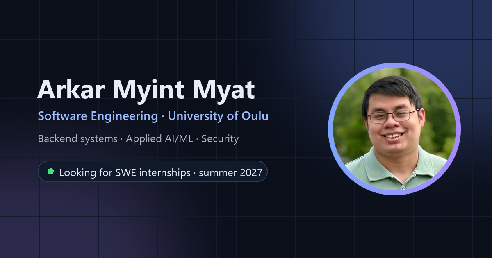

# Arkar Myint Myat · Portfolio



My personal portfolio. I'm a software engineering student at the University of Oulu, working on backend systems, applied AI/ML and security. The site presents six projects, each with its own case study covering the problem, my contribution, the technical decisions and the results.

**Live site:** [arkar-myint-myat.vercel.app](https://arkar-myint-myat.vercel.app)

## Projects featured

| Project | Area | Highlights |
|---|---|---|
| [Stakes by Kaleva](projects/stakes.html) | Full stack · AI | 2nd place at JunctionX Oulu 2026. Season simulation after every goal; AI stories checked by code |
| [ML-KEM Legacy Modernization](projects/ml-kem.html) | Security · Backend | Post-quantum key establishment for a legacy IoT system; 142 automated tests |
| [Transformer from Scratch](projects/transformer.html) | AI / ML | "Attention Is All You Need" in plain PyTorch, English → Burmese |
| [Explainable Heart Disease Risk](projects/heart-disease.html) | Machine learning | Bachelor's thesis: SHAP and LIME; 0.950 ROC-AUC |
| [MigraineMSense](projects/migrainemsense.html) | Mobile · AI/ML | LSTM next-hour risk forecast in a React Native app |
| [King of Cards](projects/king-of-cards.html) | Game development | Unity game released on Steam |

## Built with

Plain **HTML, CSS and JavaScript**. No framework, no build step, no dependencies.

- Two-column layout on desktop: the intro and section menu stay fixed on the left while the content scrolls; on phones and tablets it becomes a single column with a top bar
- The section menu highlights where you are on the page
- Light and dark themes that follow the system setting, with a manual toggle
- Accessible markup: semantic HTML, keyboard navigation, visible focus, reduced-motion support
- Screenshot lightbox, lazy-loaded WebP images, and SEO / Open Graph metadata
- Fonts: [Geist and Geist Mono](https://vercel.com/font) via Google Fonts

## Structure

```
index.html                 Homepage: intro, about me, skills, projects, contact
projects/                  One case-study page per project
assets/
  css/styles.css           All styles; design tokens (colours, type, spacing) at the top
  js/main.js               Theme toggle, mobile menu, section highlighting, lightbox, copy email
  img/arkar.webp           Portrait
  og-image.png             Social preview image (1200 × 630)
  cv/                      Resume (PDF)
  projects/<project>/      Screenshots for each project
```

## Run locally

Any static file server works. With Python:

```bash
git clone https://github.com/Arkar-MyintMyat/portfolio.git
cd portfolio
python -m http.server 8000
```

Then open <http://localhost:8000>. Opening `index.html` directly in a browser also works.

## Contact

- Email: [Arkarmyt999@gmail.com](mailto:Arkarmyt999@gmail.com)
- LinkedIn: [arkar-myint-myat07](https://linkedin.com/in/arkar-myint-myat07)
- GitHub: [Arkar-MyintMyat](https://github.com/Arkar-MyintMyat)

---

© 2026 Arkar Myint Myat. Project content, screenshots and the portrait are my own; please don't reuse them without asking.
